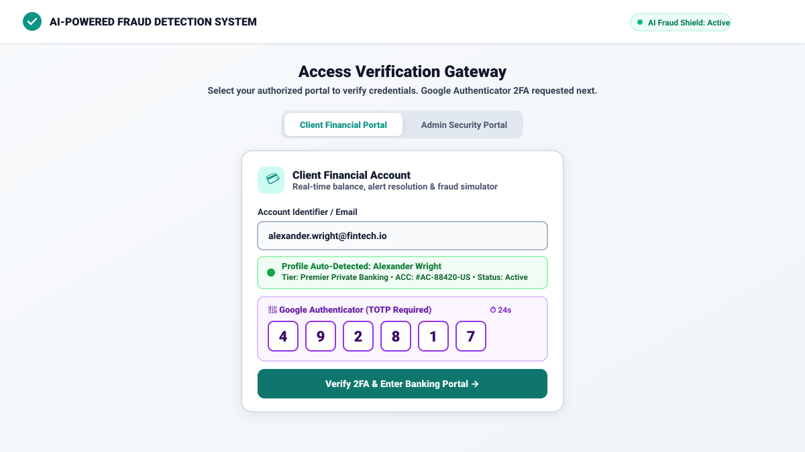
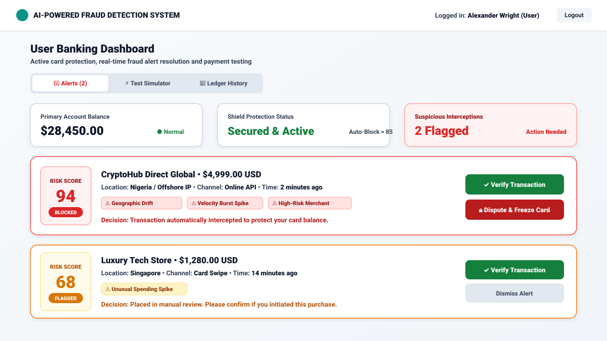
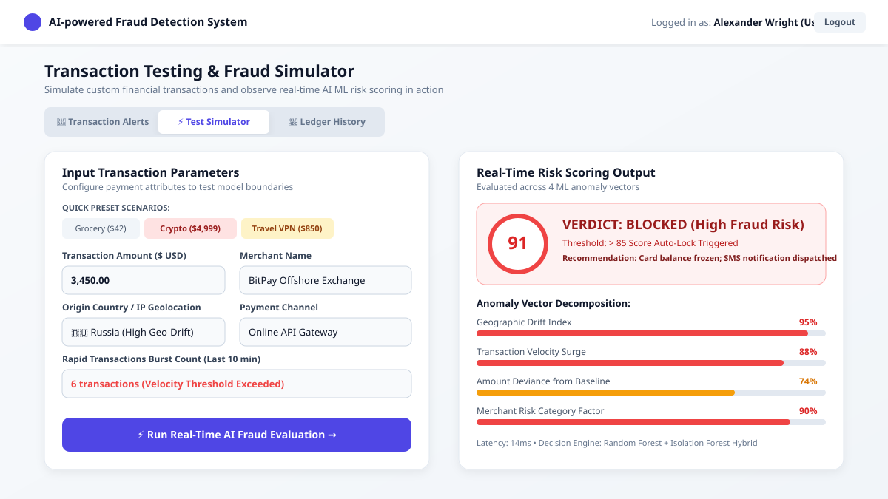
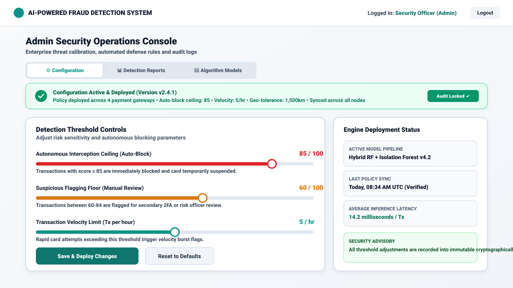
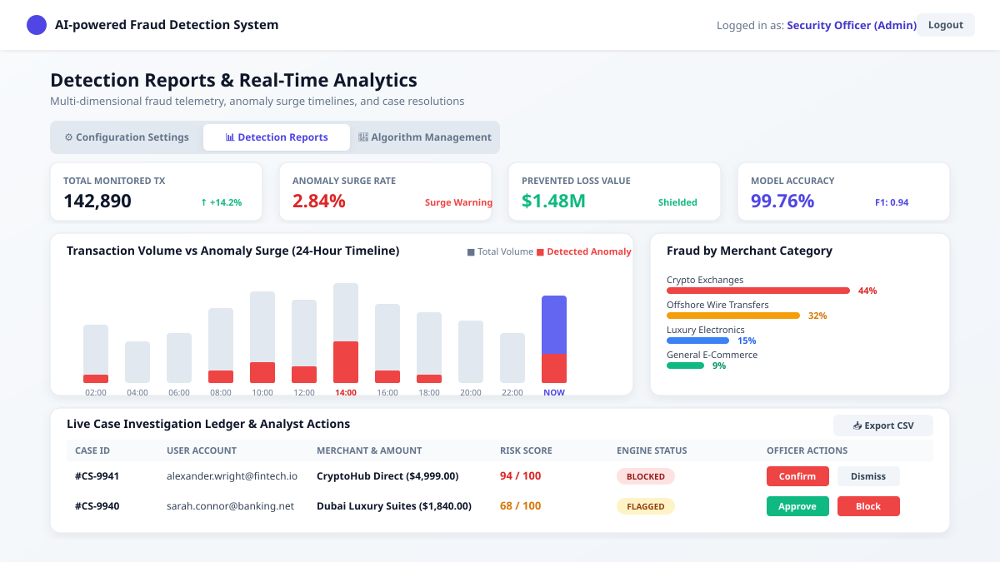
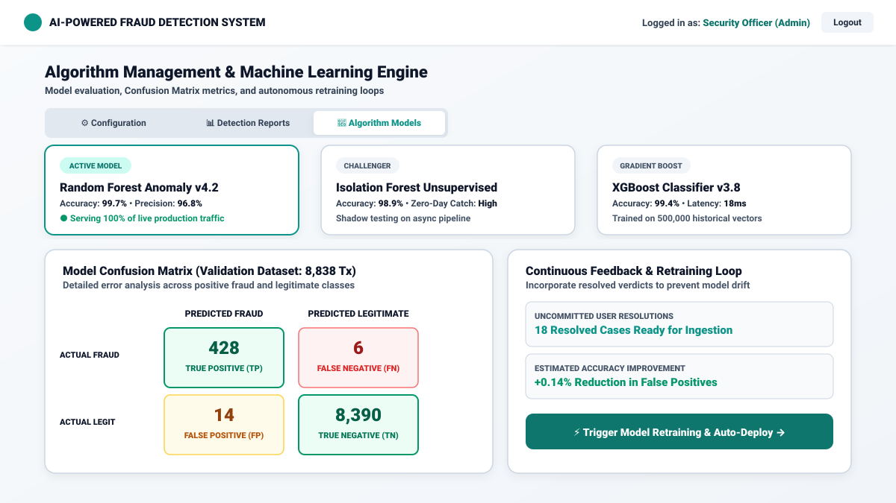

# AI-powered Fraud Detection System

## 🫥 Project Introduction
The **AI-powered Fraud Detection System** is an enterprise-grade financial security and anomaly detection platform. Powered by machine learning, it monitors financial transactions in real time, computes multi-vector risk scores, triggers cardholder security notifications, and provides risk officers with threat configuration and algorithmic retraining controls.

---

## 📝 Project Overview and Features

### 1. 🔐 Dual-Role Access & 2FA Google Authenticator Gateway
* **Isolated Portals:** Distinct, separated login flows for **Client Financial Accounts** and **Admin Security Operations**.
* **Profile Auto-Detection:** Automatically resolves user clearance tier and account metadata upon credential input.
* **Google Authenticator (TOTP):** 2-step verification with 30-second live rotating countdown timer and quick-fill test codes.



---

### 2. 🚨 User Dashboard: Real-Time Transaction Alerts & Resolution
* **High-Priority Threat Alerts:** Immediate cardholder notifications for intercepted suspicious transactions.
* **Transparent Risk Diagnostics:** Displays multi-vector risk scores (0–100), trigger reasons (geographic drift, rapid velocity bursts, high-risk merchant categories).
* **One-Click Actions:** Instant **Verify Transaction** or **Dispute & Freeze Card** buttons.



---

### 3. ⚡ User Dashboard: Transaction Testing & Fraud Simulator
* **Interactive Scenario Testing:** Test typical grocery purchases or high-risk edge cases (rapid micro-charges, offshore wires, cryptocurrency exchanges).
* **Multi-Vector Risk Decomposition:** Real-time breakdown across Geo-Drift, Velocity Spikes, Deviance from Baseline, and Merchant Category factors.
* **Live Verdict Gauge:** Sub-15ms AI inference with instant status classification (`NORMAL`, `FLAGGED`, `BLOCKED`).



---

### 4. ⚙️ Admin Dashboard: Configuration Settings & Live Deployment
* **Threat Threshold Sliders:** Fine-tune the Auto-Block ceiling, manual review floor, velocity burst frequency, and geographic anomaly radius.
* **Live Deployment Confirmation:** Active status banner showing version synchronization (v2.4.1), timestamp audit log, and multi-gateway deployment lock.



---

### 5. 📊 Admin Dashboard: Detection Reports & Visual Analytics
* **Volume vs Anomaly Timeline:** 24-hour comparative velocity bar chart highlighting surge anomalies.
* **Category & Density Analytics:** Merchant category risk distribution and risk score histogram.
* **Case Investigation Ledger:** Full transaction table with one-click analyst audit decisions and CSV export.



---

### 6. 🧠 Admin Dashboard: Algorithm Management & Retraining Loop
* **Multi-Model Evaluation:** Side-by-side performance metrics for Random Forest (v4.2), Isolation Forest, and XGBoost classifiers.
* **Live Confusion Matrix:** True Positives (428), False Positives (14), True Negatives (8,390), and False Negatives (6).
* **Continuous Feedback Loop:** Retrains and recalibrates model weights directly from cardholder dispute and verification actions.



---

## ⛏️ Tech Stack, APIs, and Other Resources
* **Frontend Framework:** React 19 + TypeScript
* **Styling & Theme:** Tailwind CSS v4 (Aesthetic Light Theme with high-contrast risk badges)
* **Icons:** Lucide React (`lucide-react`)
* **Build Tooling:** Vite & Node.js
* **Algorithms & Logic:** Hybrid Random Forest + Isolation Forest Multi-Vector Scoring Engine
* **Authentication Standards:** TOTP RFC 6238 Simulation (Google Authenticator 6-digit OTP)

---

## 🧑‍💻 Getting Started: Setup and Running Instructions

### 1. Installation
```bash
git clone <repository-url>
cd <project-folder>
npm install
```

### 2. Run Local Development Server
```bash
npm run dev
```
Open [http://localhost:3000](http://localhost:3000) in your browser.

### 3. Build & Code Quality
```bash
# Type-check and lint
npm run lint

# Production build
npm run build
```

---

## 🤝 How to Contribute and Report Issues
1. **Fork the Repository:** Create your feature branch (`git checkout -b feature/fraud-vector-enhancement`).
2. **Commit Changes:** Use semantic commit messages (`git commit -m 'feat: add device fingerprint vector'`).
3. **Open a Pull Request:** Describe the proposed improvements and test coverage.
4. **Report Issues:** Submit an issue ticket with detailed reproduction steps, logs, and screenshots.

---

## 🔥 Conclusion and License
The **AI-powered Fraud Detection System** bridges the gap between machine learning anomaly detection and practical financial operations, delivering secure banking for cardholders and high-fidelity controls for risk analysts.

Released under the **Apache-2.0 License**.
